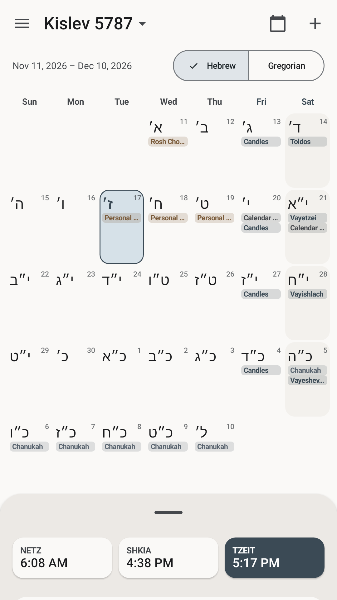
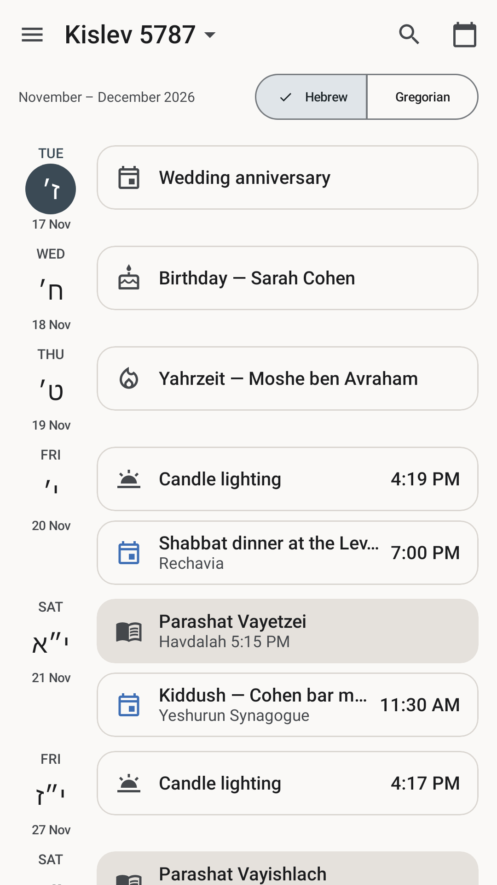
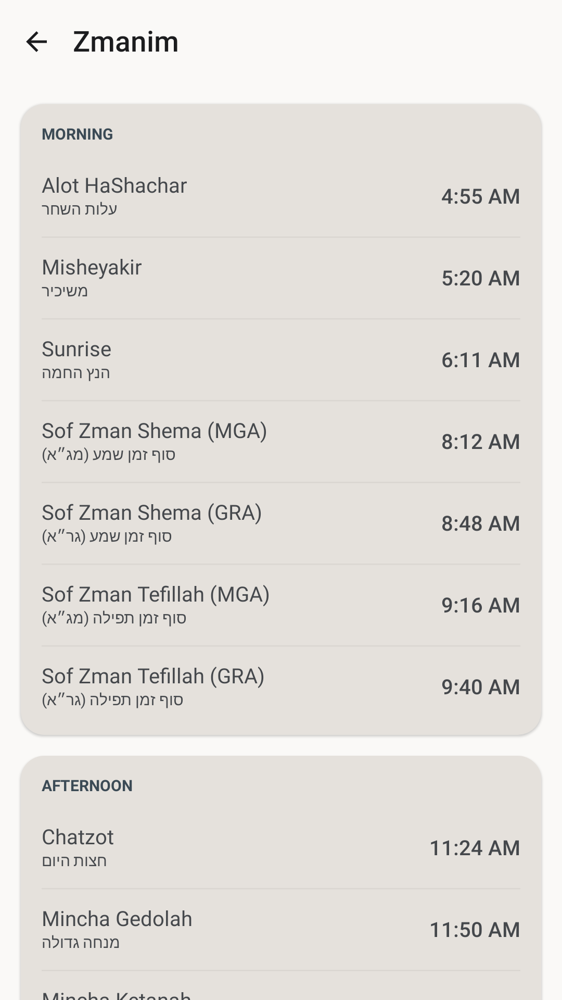

## Description

<!-- SECTION:DESCRIPTION:BEGIN -->
Prepare the merge request against https://gitlab.com/fdroid/fdroiddata from a fork, with the metadata, compliance evidence, reproducibility results and references. **Do not open or submit it without explicit owner authorization.** After submission, track the reviewers' feedback and the first F-Droid build, and update the docs with anything learned.
<!-- SECTION:DESCRIPTION:END -->

## Acceptance Criteria
<!-- AC:BEGIN -->
- [ ] #1 MR prepared and reviewed by the owner; submitted only after authorization; review feedback addressed; the app is published on F-Droid with our signature
<!-- AC:END -->

## Implementation Plan

<!-- SECTION:PLAN:BEGIN -->
Scope (coordinator 2026-11-08): steps 1-2 plus a draft MR text. No fork, push to GitLab, or MR. Nothing under fastlane/ changed.
1. Recipe to v0.4.4: replace the 0.4.3 build entry with 0.4.4/404 at the v0.4.4 tag commit (25f8f89a…), drop the prebuild sed (v0.4.4 has signingConfigs.findByName - confirmed in the tag's app/build.gradle.kts), CurrentVersion 0.4.4/404. Confirm the published fdroid-version.txt on v0.4.4 reads 404/0.4.4. Update docs/fdroid/README.md and COMPLIANCE.md where they cite 0.4.3 or the prebuild.
2. Revalidate in /tmp/levana-task-53.6-evidence: fresh shallow fdroiddata master clone, fdroidserver pinned as in 53.5; readmeta, rewritemeta (no diff), lint, check-jsonschema, tools/check-* as in .gitlab-ci.yml; checkupdates on the real URL (expect up to date); fdroid build :404 with reference-binary comparison against levana-v0.4.4.apk in the 53.5 arm64 Debian 13 stand-in; independent apksigcopier compare --unsigned; fastlane listing read via fdroidserver without truncation.
3. Draft MR (branch, commit message, title, description from fdroiddata's current new-app template) at /tmp/levana-task-53.6-evidence/MR.md and in these notes.
4. AGENTS.md build command; record results; commit docs/fdroid + task on the branch. AC #1 stays unchecked.
<!-- SECTION:PLAN:END -->

## Implementation Notes

<!-- SECTION:NOTES:BEGIN -->
## 2026-11-08 run (@claude), branch task-53.6-fdroid-mr-prep: recipe to v0.4.4, revalidation, MR draft
Scope: steps 1-2 plus the MR draft. Nothing forked, pushed to GitLab or submitted; nothing under fastlane/ changed. AC #1 stays open (submission and publication).

### Recipe (docs/fdroid/ninja.doskey.app.levana.yml)
- Build entry 0.4.3/403 replaced by 0.4.4/404 at commit 25f8f89a50dfb10316af35df7864df6053da4e4d (tag v0.4.4).
- prebuild sed dropped: the v0.4.4 tag's app/build.gradle.kts uses signingConfigs.findByName("release"), and the F-Droid build of v0.4.4 passed without it.
- CurrentVersion 0.4.4 / CurrentVersionCode 404. Everything else unchanged.
- The v0.4.4 release's fdroid-version.txt reads versionCode=404 / versionName=0.4.4, and releases/latest redirects to v0.4.4.
  GitHub's release CDN returned 504 for every repo from about 09:05 to 10:59 UTC; I retried after it recovered.

### Validation (evidence: /tmp/levana-task-53.6-evidence/README.md)
fdroiddata master bd34407b (fresh shallow clone), fdroidserver master cdfdce83 (same pin as 53.5; still master today). Each job run as in .gitlab-ci.yml.
- readmeta: PASS. rewritemeta: PASS, no diff. lint: PASS, no warnings. git redirect: PASS.
- check-jsonschema (metaschema + recipe): PASS. tools/check-exif-in-images, check-localized-metadata, check-keyalias-collision, check-metadata-summary-whitespace, check-for-unattached-signatures, make-summary-translatable: PASS, empty reports.
- checkupdates --auto on the real URL: PASS, "...up to date", no diff.
- fdroid build --test --refresh-scanner --on-server --no-tarball ninja.doskey.app.levana:404: PASS.
  - "compared built binary to supplied reference binary successfully"
  - "supplied reference binary has allowed signer ab02841e88825c51c8f0b0f013ff4e312bca47ea1bfbffa894b51890ad5a5117"
  - OpenJDK 21.0.13, Gradle 8.13 via gradlew-fdroid. Scanner: only gradle-wrapper.jar removed.
  - Third attempt. Attempt 1 failed on the GitHub CDN outage (the Gradle download redirects to GitHub). Attempt 2 failed on my stand-in: root's sdkmanager step created /opt/android-sdk/build-tools root:755. Fixed by pre-creating build-tools/platforms/ndk as root:vagrant 775, as in the official image.
- Independent apksigcopier 1.1.1 compare --unsigned levana-v0.4.4.apk vs F-Droid's unsigned build: exit 0.
  - aapt2 badging: both ninja.doskey.app.levana 404/0.4.4.
  - SHA-256: GitHub 4c08e5d3…aff5, F-Droid unsigned 2506311c…9925.
- Fastlane at v0.4.4, read with fdroidserver's insert_localized_app_metadata: nothing truncated.
  - Text: title 23/50, summary 70/80, description 671/4000, whatsNew 404 432/500.
  - Images: icon 512x512, featureGraphic 1024x500, 8 phoneScreenshots 1080x1920.
- Build environment (same approach as 53.5): arm64 Debian 13 stand-in for buildserver-trixie (scripts/buildserver-arm64/Dockerfile), built in the default colima profile with no new VM.
  - Debian trixie openjdk-21-jdk-headless 21.0.13, fdroidserver/sdkmanager debs for dependencies.
  - SDK licences, bsenv.sh, gradlew-fdroid and buildserverid copied from the local registry.gitlab.com/fdroid/fdroidserver:buildserver image (amd64, Debian 13, 2026-10-21).
  - libc6/libstdc++6/zlib1g:amd64 so the x86-64 aapt2 runs under colima's qemu binfmt.
  - Limitation: not the real amd64 buildserver-trixie image, which is too slow under qemu on Apple silicon. The MR pipeline is the first run on the real image.
  - Container I/O uses docker cp (colima doesn't share /tmp).
- AGENTS.md command (assembleDebug testDebugUnitTest lintDebug) at 5816ae0 plus the docs-only changes: BUILD SUCCESSFUL, 1251 tests, 0 failures, 8 skipped.

### Docs
- README.md: 0.4.4 / 404 in the update-check text; the signing-config section now says the recipe starts at v0.4.4 with no prebuild; JDK note and example tags at v0.4.4.
- COMPLIANCE.md:
  - Test results replaced with this run.
  - The v0.4.4 listing check, with changelog 404 added.
  - The location-name lookup documented: platform Geocoder, the app opens no connection, falls back to "Current Location". The NonFreeNet row is corrected to match; it previously said the update check was the only network use.
  - Remaining blockers reduced to the submission (fdroid-version.txt, findByName and the listing are resolved) plus TASK-63.

### MR draft
/tmp/levana-task-53.6-evidence/MR.md, copied below.
- Branch ninja.doskey.app.levana; commit and title "New app: Levana".
- Uses fdroiddata's current .gitlab/merge_request_templates/Default.md.
- No RFP or fdroiddata issue or MR for Levana exists (GitLab API search for levana and ninja.doskey), so "Closes rfp#" is removed.
- Owner to review: the "why you wrote this app" paragraph (drafted, marked), and the Docs/Pipeline/fork checkboxes (left unticked).

### Remaining for the owner
- A GitLab account.
- A public fork of fdroid/fdroiddata.
- Authorization to push the branch and open the MR.
- Then: CI on the real buildserver image, reviewer feedback, and the first F-Droid publication (AC #1).
- If a newer release ships first, replace the build entry with it.
- Cleanup: docker image levana-fdroid-buildserver-arm64:53.6 can be removed after submission.

### MR draft text (MR.md)

# fdroiddata merge request draft: New app: Levana

Draft only. Nothing has been forked, pushed or opened. Owner review and authorization required.

## Git

- Fork: `https://gitlab.com/<owner-gitlab-user>/fdroiddata` (public; branch not protected)
- Branch: `ninja.doskey.app.levana`
- Files: one, `metadata/ninja.doskey.app.levana.yml` (= `docs/fdroid/ninja.doskey.app.levana.yml` in the Levana repo)
- Commit message:

```
New app: Levana
```

- MR title: `New app: Levana`
- Target: `fdroid/fdroiddata` `master`

## MR description

(The text below follows fdroiddata's `.gitlab/merge_request_templates/Default.md` as of fdroiddata master `bd34407b`.)

---

## Abstract for new app inclusion

### Please introduce the functions and usage of your app in summary, and also attach some screenshots.

Levana is a Hebrew calendar for Orthodox Jewish users in Israel and the Diaspora. All calendar
calculations (KosherJava) and stored data work offline. No ads, no analytics, no accounts.

- Hebrew and Gregorian month views, plus an Agenda with search
- Holidays, fasts, parsha, Omer and molad, for Israel or the Diaspora
- Zmanim, candle lighting and havdalah for the current location or any city
- Yahrzeits, Hebrew birthdays and other events by their Hebrew date
- The phone's calendar events alongside the Jewish dates
- Reminders for candle lighting, holidays, fasts, the Omer and personal events
- Widgets, a Quick Settings tile and a launcher icon showing today's Hebrew date
- Hebrew or English, light or dark

Screenshots (from the upstream Fastlane folder at v0.4.4):





### Please elaborate why you wrote this app. Please highlight the unique functions it provides over other similar apps in F-Droid.

<!-- OWNER: replace or confirm this paragraph; it is not a claim about other apps. -->
I wanted one free, offline Hebrew calendar that combines the Jewish calendar, zmanim and personal
Hebrew-date events (yahrzeits, Hebrew birthdays, including those of device contacts) with the
phone's own calendar, reminders and home-screen widgets, in Hebrew or English, for both Israel and
the Diaspora.

### Notes for reviewers

- **Licence:** MIT (`LICENSE`). Bundled libraries are Apache-2.0, BSD-3-Clause, MIT and LGPL-2.1
  (KosherJava, unmodified Maven artifact); see `THIRD_PARTY_NOTICES.md`. No Google Play Services,
  Firebase, analytics or ads.
- **Reproducible build with our signature:** `Binaries` points to the signed APK on GitHub
  Releases, and `AllowedAPKSigningKeys` is its certificate SHA-256
  (`ab02841e88825c51c8f0b0f013ff4e312bca47ea1bfbffa894b51890ad5a5117`, also the Play app-signing
  key). The upstream CI rebuilds every release tag without the key and runs
  `apksigcopier compare --unsigned` against the published APK
  (`.github/workflows/verify-release.yml`). The recipe needs no `prebuild` and no JDK install: the
  buildserver's OpenJDK 21 produces the same APK as the release workflow's Temurin 17.
- **No anti-features**, in our assessment:
  - The `INTERNET` permission is for an update check for sideloaded GitHub installs: a daily
    request to the GitHub Releases API that offers a link to the release page. It sends no
    identifiers and is **skipped when the installer is F-Droid** (`org.fdroid.fdroid`) or Play
    (`UpdateSource.kt`). (Recognising other F-Droid clients is tracked upstream.)
  - The current location's display name comes from the platform `android.location.Geocoder`. The
    app opens no connection for it; if the device has no geocoding provider, it shows
    "Current Location". Zmanim use only the coordinates.
  - Crash reports: ACRA in dialog + email mode only. After a crash the app asks the user, and a
    report is sent only if the user confirms and sends the prepared email themselves (version,
    Android version, device model, date, stack trace; no logcat or app data).
- **Update check:** versionCode is `major*10000 + minor*100 + patch` of the tag and is not in the
  tag name, so `UpdateCheckMode: Tags` can't derive it. The recipe uses `UpdateCheckMode: HTTP`
  on `releases/latest/download/fdroid-version.txt`, a release asset
  (`versionCode=404` / `versionName=0.4.4`) that upstream CI uploads only after the
  reproducibility check passes; `AutoUpdateMode: Version v%v` then builds the tag.
- **Store metadata:** Fastlane, `en-US`, in the upstream repo (`fastlane/metadata/android/en-US/`):
  title, summary, description, icon, feature graphic, 8 screenshots and per-versionCode changelogs.
- **Local validation** (fdroiddata master `bd34407b`, fdroidserver master `cdfdce83`, each job run
  as in `.gitlab-ci.yml`):
  - `fdroid readmeta`, `fdroid rewritemeta` (no changes), `fdroid lint` (no warnings): pass
  - git redirect, JSON schema and all `tools/check-*` scripts: pass
  - `fdroid checkupdates --auto` on the real URL: up to date at 0.4.4 / 404, no changes
  - `fdroid build --test --refresh-scanner --on-server --no-tarball ninja.doskey.app.levana:404`:
    pass, "compared built binary to supplied reference binary successfully" and "supplied
    reference binary has allowed signer ab02841e…5117" (OpenJDK 21.0.13; the scanner only
    removed `gradle-wrapper.jar`)
  - `apksigcopier compare --unsigned levana-v0.4.4.apk <F-Droid build>`: exit 0
  - The build ran in an arm64 Debian 13 container set up like `buildserver-trixie` (the amd64
    image is too slow under emulation on Apple silicon), so this pipeline is the first run on
    the real image.

## Checklist

### Policy

* [x] The app complies with the [inclusion policy](https://f-droid.org/docs/Inclusion_Policy). _Pay special attention to Quality point 6._
* [x] The original app author has been notified (and does not oppose the inclusion). If you are not the author, please paste the link of the reply from the author. — I am the author.
* [x] The upstream app source code repo contains the app metadata in a [Fastlane](https://gitlab.com/snippets/1895688) or [Triple-T](https://gitlab.com/snippets/1901490) folder structure. The summary and description must be included and images, icon, and changelog should also be provided for better user experience. The `en-US` locale must be included.

### Docs

* [ ] Please read [the guide](https://gitlab.com/fdroid/fdroiddata/-/blob/master/CONTRIBUTING.md) first if this is your first contribution.
* [ ] Please make sure your metadata follows the best practice in [our templates](https://gitlab.com/fdroid/fdroiddata/tree/master/templates).
* [ ] Please read the [Build Metadata Reference](https://f-droid.org/docs/Build_Metadata_Reference/) and make sure your metadata is valid.
* [ ] Please read the [Quick Start Guide](https://f-droid.org/en/docs/Submitting_to_F-Droid_Quick_Start_Guide/).

### Merge Request Setup

* [x] The title of this merge request should follow "New app: app name" format.
* [ ] Please make sure your fdroiddata fork is public and your branch is not protected. See <https://docs.gitlab.com/user/project/repository/branches/protected/>.
* [x] Please read [our Git guide](https://gitlab.com/fdroid/wiki/-/wikis/Tips-for-fdroiddata-contributors/Git-Usage) if you don't know how to rebase your branch. Don't rebase your branch if there is no conflict.
* [x] All related [fdroiddata](https://gitlab.com/fdroid/fdroiddata/issues) and [RFP issues](https://gitlab.com/fdroid/rfp/issues) have been referenced in this merge request — none exist.
* [x] Please only submit one app in one MR.

### Metadata

* [x] Metadata must be put in `metadata/<applicationId>.yml`.
* [x] Metadata must be a valid YAML file.
* [x] Metadata must use LF as line ending.
* [x] Don't add summary/description/changelog/images or anything that should be provided in upstream repo. Please check the Changes tab to make sure there is no other unrelated files added in the MR.
* [x] Releases are tagged and auto update is enabled unless there is a special reason.
* [x] There is an issue tracker and contact info of the author so that we can report bugs and contact the author.
* [x] An AuthorName must be added. It doesn't need to be the real name.
* [x] External repos are added as git submodules instead of srclibs. You can update git submodules without opening an MR in this repo and the submodule is covered by our scanner. — none used.
* [x] Enable [Reproducible Builds](https://f-droid.org/docs/Reproducible_Builds). We'll use your signature for improved security/reliability, also allowing users to switch between different channels. Do note that if you don't enable reproducible build then the apk will be signed with our key so you can't enable it later. If you can't enable this, please add the reasons here.
* [x] Setup abi split if the APK is large and the splitted ones can be much smaller. — not needed: 5.3 MB, no app native code.
* [x] Only the latest versions should be kept in the metadata before it's merged. If you update the metadata, please replace the old versions with the new ones.
* [x] Don't add any disabled versions in the metadata.
* [x] The `commit` field should be the full hash. Please don't use tag or branch in commit.

### Pipeline

* [ ] All pipelines should pass.
* [ ] All warnings and errors in the Reports tab should be fixed or explained.
* [ ] F-Droid CI runners are under GitLab's FOSS program, so there's no need for you to pay for any CI time. If Gitlab starts asking for phone numbers or credit cards don't submit anything, just leave a note in the MR so we know we need to trigger the CI.

---------------------

/label ~"New App"

---

## Owner notes (not part of the MR)

- The "Docs" boxes are for the submitter to tick after reading those pages; the "Pipeline" boxes
  after the MR pipeline runs. The fork-visibility box after creating the fork.
- `Closes rfp#…` was removed: there is no RFP issue for Levana.
- If a newer Levana release exists at submission time, replace the build entry with it (full
  commit hash) and set CurrentVersion/CurrentVersionCode, per "Only the latest versions".

## 2026-11-08 submitted (coordinator, owner-authorized)
- Fork https://gitlab.com/dbrodie/fdroiddata (public), branch ninja.doskey.app.levana, commit 5ad24111 'New app: Levana' on fdroiddata master 5f2bae92; one file, metadata/ninja.doskey.app.levana.yml, byte-identical to docs/fdroid/ninja.doskey.app.levana.yml (the validated v0.4.4 recipe).
- MR: https://gitlab.com/fdroid/fdroiddata/-/merge_requests/56365 'New app: Levana'. Description = /tmp/levana-task-53.6-evidence/MR-description.md (owner-revised 'why I wrote this app' paragraph focused on open source and Hebrew-date notifications; adds 'This project uses AI-generated code and assets.').
- Pipeline: GitLab failed both pipelines with no jobs, 'The pipeline failed due to the user not being verified'. Per the MR template the account was not verified; a note asks maintainers to trigger CI: https://gitlab.com/fdroid/fdroiddata/-/merge_requests/56365#note_4187409460
- Next: maintainers run the pipeline on the real buildserver image; address review feedback; tick the Docs/Pipeline checkboxes; first publication with our signature (AC #1). If a newer release ships before merge, replace the build entry.

## 2026-11-13 deferred (coordinator)
- MR !56365 was closed by the owner on 2026-11-08 without review (its pipeline never ran: unverified GitLab account). Submission is deferred to the future; the task is back in To Do.
- Nothing more is needed in this repo: the recipe reference copy is docs/fdroid/ninja.doskey.app.levana.yml (validated for v0.4.4), every release publishes fdroid-version.txt (verify-release.yml), and the signingConfigs fix is in.
- To resubmit: update the build entry to the then-current release (full commit hash, versionName/versionCode, CurrentVersion*) in fdroiddata's metadata/ninja.doskey.app.levana.yml (and refresh the docs copy), revalidate, then reopen !56365 or open a new MR from dbrodie/fdroiddata (branch ninja.doskey.app.levana still exists). The MR text is in these notes and /tmp/levana-task-53.6-evidence/MR-description.md. The pipeline needs a verified GitLab account or a maintainer to trigger it.
- Cleanup when done: docker image levana-fdroid-buildserver-arm64:53.6, colima profile 'fdroid'.
<!-- SECTION:NOTES:END -->
